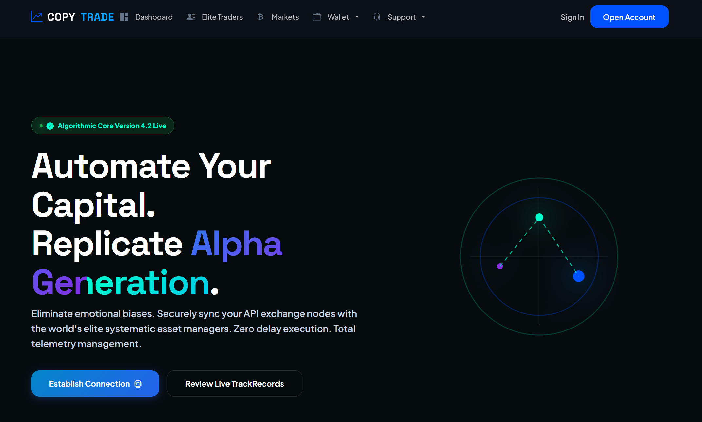
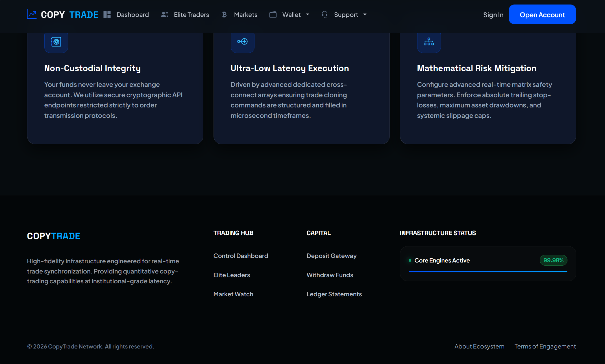
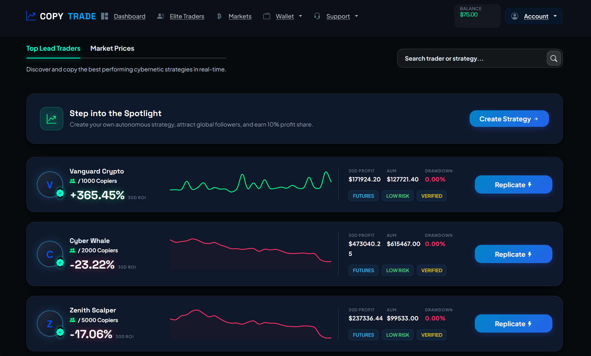
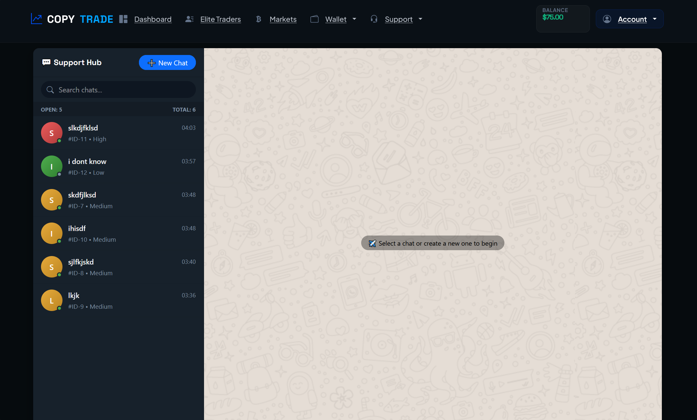
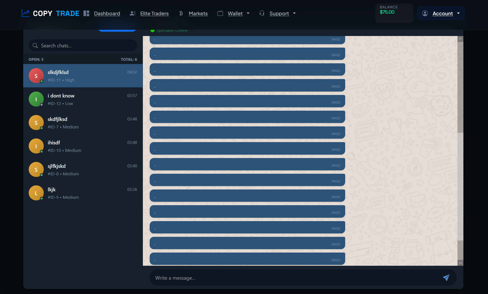
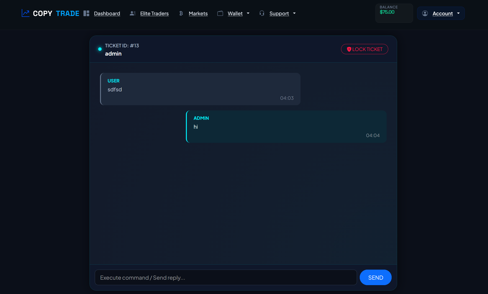

# 📈 Smart Trade Dashboard – Advanced Copy-Trading Architecture

<div align="center">


<br>

<a href="https://smart-trade-demo.onrender.com/" target="_blank">
  
</a>

<br>
<br>

**🔑 Demo Credentials:**
| Email | Password |
| :--- | :--- |
| `demo@smarttrade.com` | `demo12345` |

*(Note: The demo is hosted on a free tier and may take ~30 seconds to wake up on the first request.)*

</div>

---

Smart Trade Dashboard is a enterprise-grade, high-performance copy-trading simulation platform architected with Python/Django and real-time client-side interactive rendering. Inspired by tier-1 crypto exchanges like **BingX** and **Bitget**, this ecosystem models advanced internal ledger management, real-time matrix analytics, risk vectoring, and algorithmic trader replication protocols.

This repository demonstrates advanced full-stack capabilities, showcasing secure transaction structures, data concurrency handling, and sleek cyberpunk-themed data visualizations.

---

## 🎨 System Previews & Interface Showcase

<div align="center">

  <table style="width: 100%; max-width: 880px; border: 2px solid #0052ff; border-radius: 12px; overflow: hidden; box-shadow: 0 0 30px rgba(0, 82, 255, 0.25); background: #0b0f1e;">
    <tr>
      <td align="center" style="padding: 12px;">
        
        <div style="margin-top: 10px; font-family: monospace; font-size: 0.8rem; color: #0052ff; letter-spacing: 2px; font-weight: bold;">
          ⚡ [MASTER_NODE_ALPHA] // ROOT OVERRIDE INTERFACE
        </div>
      </td>
    </tr>
  </table>

  <br>

  <table style="width: 100%; max-width: 880px; border-collapse: separate; border-spacing: 16px 12px;">
    <tr>
      <td width="50%" align="center" style="background: rgba(15, 23, 42, 0.6); border: 1px solid rgba(255,255,255,0.06); border-radius: 10px; padding: 10px; box-shadow: 0 4px 20px rgba(0,0,0,0.3);">
        
        <div style="margin-top: 8px; font-family: monospace; font-size: 0.7rem; color: #10b981; letter-spacing: 1px;">💾 NODE_02 // SUBSYSTEM_V2</div>
      </td>
      <td width="50%" align="center" style="background: rgba(15, 23, 42, 0.6); border: 1px solid rgba(255,255,255,0.06); border-radius: 10px; padding: 10px; box-shadow: 0 4px 20px rgba(0,0,0,0.3);">
        
        <div style="margin-top: 8px; font-family: monospace; font-size: 0.7rem; color: #10b981; letter-spacing: 1px;">💾 NODE_03 // SUBSYSTEM_V3</div>
      </td>
    </tr>
    <tr>
      <td width="50%" align="center" style="background: rgba(15, 23, 42, 0.6); border: 1px solid rgba(255,255,255,0.06); border-radius: 10px; padding: 10px; box-shadow: 0 4px 20px rgba(0,0,0,0.3);">
        
        <div style="margin-top: 8px; font-family: monospace; font-size: 0.7rem; color: #0052ff; letter-spacing: 1px;">💾 NODE_04 // SUBSYSTEM_V4</div>
      </td>
      <td width="50%" align="center" style="background: rgba(15, 23, 42, 0.6); border: 1px solid rgba(255,255,255,0.06); border-radius: 10px; padding: 10px; box-shadow: 0 4px 20px rgba(0,0,0,0.3);">
        
        <div style="margin-top: 8px; font-family: monospace; font-size: 0.7rem; color: #0052ff; letter-spacing: 1px;">💾 NODE_05 // SUBSYSTEM_V5</div>
      </td>
    </tr>
    <tr>
      <td width="50%" align="center" style="background: rgba(15, 23, 42, 0.6); border: 1px solid rgba(255,255,255,0.06); border-radius: 10px; padding: 10px; box-shadow: 0 4px 20px rgba(0,0,0,0.3);">
        
        <div style="margin-top: 8px; font-family: monospace; font-size: 0.7rem; color: #ff3b30; letter-spacing: 1px;">💾 NODE_06 // SUBSYSTEM_V6</div>
      </td>
      <td width="50%" align="center" style="background: rgba(15, 23, 42, 0.6); border: 1px solid rgba(255,255,255,0.06); border-radius: 10px; padding: 10px; box-shadow: 0 4px 20px rgba(0,0,0,0.3);">
        
        <div style="margin-top: 8px; font-family: monospace; font-size: 0.7rem; color: #ff3b30; letter-spacing: 1px;">💾 NODE_07 // SUBSYSTEM_V7</div>
      </td>
    </tr>
  </table>

</div>

---

## 🚀 Core Engine Architectural Highlights

### ⚡ Mathematical PnL Persistence Logic
When investors top up an existing active copy-trading slot, adding capital blindly alters the arithmetic basis of their ongoing returns. This engine implements a **Proportional Scaling Adjustment Protocol**. Upon deposit modification, the backend intercepts the current `entry_roi` alongside the lead trader’s instantaneous performance vectors:
* Calculates current percentage change relative to baseline vectors.
* Computes an inverse mathematical adjustment factor:
  $$\text{Adjustment Factor} = 1 + \left(\frac{\Delta \text{ROI}}{100}\right)$$
* Modifies the underlying investment principal dynamically so that front-end yield formulas remain completely coherent and uniform without distorting historical profit tracking.

### 🔒 Concurrency Control & Thread Safety
To prevent double-spend vectors, multi-request lag exploitations, or race-conditions while settlement procedures execute (e.g., stopping copy tasks or applying liquidations), the system forces row-level database locks utilizing Django’s raw database interception layer:
```python
User.objects.select_for_update().get(id=request.user.id)

```

This guarantees an isolated state operation inside a `transaction.atomic()` context block until calculations are fully committed to the global ledger.

### 📊 Matrix Visualization Overlay (Admin vs Investor UI)

Rather than displaying a rigid layout, the front-end features an adaptive canvas system utilizing `Chart.js` combined with a responsive vector manipulation layer (`chartjs-plugin-dragdata`):

* **Admin-Root Mode:** Grants direct manipulation arrays. Administrators can drag nodes across a strict constraint grid ($-100\%$ to $+1000\%$). Saving the chart transmits the absolute raw sequence into a unified Django `JSONField` while continuously adapting the final `roi_30d` index automatically.
* **Investor Mode:** Locks drag physics completely. Restructures vectors into custom data slices over a localized state machine ($1\text{D}$, $7\text{D}$, $30\text{D}$) accompanied by smooth ease-out transitions and neon glowing cyber-gradients.

---

## ⚙️ Technical Blueprint & Stack Components

* **Core Framework:** Python 3.12+ / Django 6.0.1 (Strictly decoupled architecture utilizing layered application wrappers).
* **Asynchronous Integration & Price Ingestion:** Native abstract services interface connecting seamlessly with dynamic crypto data endpoints.
* **Frontend Infrastructure:** Semantic HTML5 modules wrapped inside high-performance responsive flexgrids, vanilla ES6 JavaScript engines handling secure AJAX token streams.
* **Data Persistence Engine:** Structured schema design configured for immediate PostgreSQL deployment (SQLite fallback provided for decoupled local debugging environments).

---

## 📁 Repository Directory Blueprint

```plaintext
smart-trade-dashboard/
│
├── apps/
│   ├── trading/         # Handles position links, PnL math, and lead vector overrides
│   ├── accounts/        # Manages session controls, tracking protocols, and permissions
│   └── transactions/    # Controls global accounting ledger structures and validations
│
├── core/                # System core configurations and security settings
├── static/              # Production asset compilations (CSS variables, Cyberpunk UI scripts)
├── templates/           # Split layout modules (granular admin views / clean investor dashboards)
├── manage.py
├── requirements.txt
└── .gitignore

```

---

## 🧩 Quick-Start Infrastructure Setup

### 1️⃣ Obtain Local Environment

```bash
git clone https://github.com/MohammadSalkhorde/smart-trade-dashboard.git
cd smart-trade-dashboard

```

### 2️⃣ Isolate Virtual Environment

```bash
python -m venv venv
# Activation wrapper on Windows environments
venv\Scripts\activate
# Activation wrapper on UNIX/macOS environments
source venv/bin/activate

```

### 3️⃣ Ingest Platform Prerequisites

```bash
pip install -r requirements.txt

```

### 4️⃣ Map Structural Relations

```bash
python manage.py makemigrations
python manage.py migrate

```

### 5️⃣ Boot Local Host Node

```bash
python manage.py runserver

```

The node will bind actively to your loopback address. Direct your browser agent to: **`http://127.0.0.1:8000/`**

---

## 📄 Licensing

Distributed under the **MIT License**. Check the root license configuration bundle for precise implementation rights.

---

## 💼 Developer Credentials & Technical Vector

**Mohammad Salkhorde** *Python / Django Back-End Engineer & Software Architect*

* **GitHub:** [github.com/MohammadSalkhorde](https://github.com/MohammadSalkhorde)
* **LinkedIn:** [linkedin.com/in/mohammad-salkhorde-a13767385](https://www.linkedin.com/in/mohammad-salkhorde-a13767385)
* **Professional Portfolio:** [mohammad-salkhorde.ir](https://mohammad-salkhorde.ir)
* **Direct Network Access:** m.salkhorde444@gmail.com