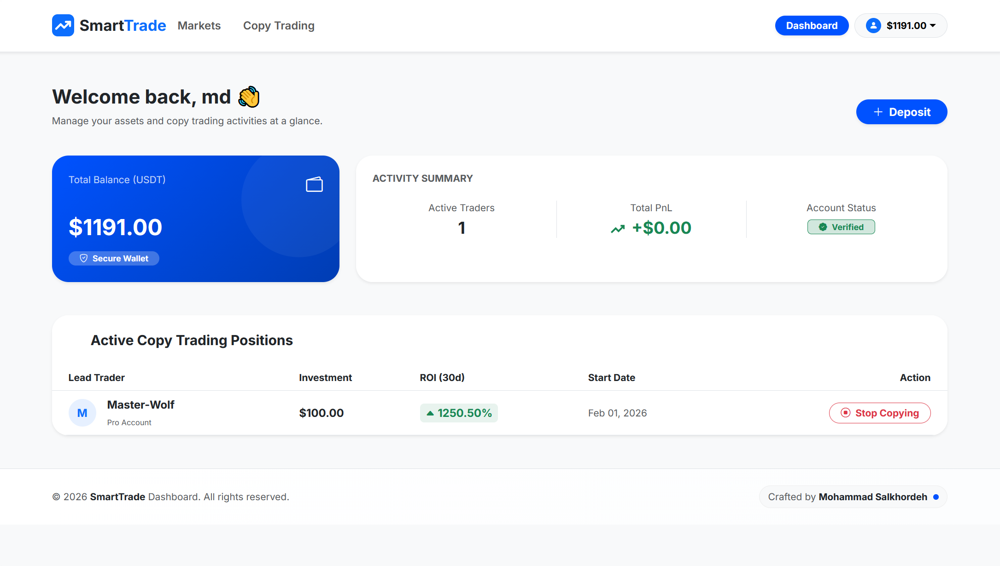

# 📈 Smart Trade Dashboard – Advanced Copy-Trading Platform


<p align="center">
  
</p>

**Smart Trade Dashboard** is a **professional, high-performance copy-trading platform** designed for cryptocurrency and financial market enthusiasts.  
Inspired by modern exchanges like **BingX**, it delivers real-time trader analytics, automated follow logic, and interactive financial dashboards.

This project is ideal for **portfolio showcase**, **fintech demonstrations**, and as a **foundation for production-ready trading systems**.

---

## 🚀 Key Highlights

- 📊 Real-time ROI, PnL, and drawdown analytics  
- 🤖 Automated copy-trading logic for following lead traders  
- 📈 Interactive financial charts powered by ApexCharts.js  
- 🎨 Clean, professional light-mode dashboard UI  
- 🔐 Secure CSRF protection and Cloudflare Tunnel support  

---

## 🧠 Technologies

- **Backend:** Python 3.12+, Django 6.0.1  
- **Frontend:** HTML5, CSS3 (Tailwind / Bootstrap), JavaScript (ES6+)  
- **Charts:** ApexCharts.js  
- **Database:** SQLite (Development), PostgreSQL (Production-ready)  
- **Tunneling:** Cloudflare Tunnels  

---

## ⚙️ Features

### 👤 User & Investor Dashboard

- Discover and follow top lead traders  
- Real-time portfolio and performance tracking  
- Complete transaction history (deposits, withdrawals, trades)  
- Daily / Weekly / Monthly profit analysis with visual charts  

### 📊 Lead Trader Management (Admin)

- Manage Win Rate, ROI, and Drawdown metrics  
- Strategy tagging based on risk level (Low / Medium / High)  
- Trading style categorization (Scalping / Swing / Long-term)  
- Monitor investor and follower statistics  

### 📈 Financial Charting

- Interactive equity curves and performance charts  
- Real-time updates without page reloads  
- Fully synchronized with backend data  

---

## 🧩 Installation & Setup

### 1️⃣ Clone the project

```bash
git clone https://github.com/MohammadSalkhorde/smart-trade-dashboard.git
cd smart-trade-dashboard
```

### 2️⃣ Create and activate a virtual environment

```bash
python -m venv venv

# Windows
venv\Scripts\activate

# Linux / macOS
source venv/bin/activate
```

### 3️⃣ Install dependencies

```bash
pip install -r requirements.txt
```

### 4️⃣ Configure settings

Ensure the following settings are properly configured in `core/settings.py`:

```python
ALLOWED_HOSTS = []
CSRF_TRUSTED_ORIGINS = []
```

### 5️⃣ Apply migrations

```bash
python manage.py makemigrations
python manage.py migrate
```

### 6️⃣ Run the development server

```bash
python manage.py runserver
```

Access the application at **http://127.0.0.1:8000/**

---

## 📁 Project Structure

```plaintext
smart-trade-dashboard/
│
├── apps/
│   ├── trading/
│   ├── users/
│   └── transactions/
│
├── core/
├── static/
├── templates/
├── manage.py
├── requirements.txt
└── .gitignore
```

---

## 📄 License

This project is licensed under the **MIT License**.

---

## 💼 Contact & Portfolio

**Mohammad Salkhorde**  
Python / Django Backend Developer

- GitHub: https://github.com/MohammadSalkhorde  
- LinkedIn: https://www.linkedin.com/in/mohammad-salkhorde-a13767385  
- Portfolio: https://mohammad-salkhorde.ir  
- Email: m.salkhorde444@gmail.com
